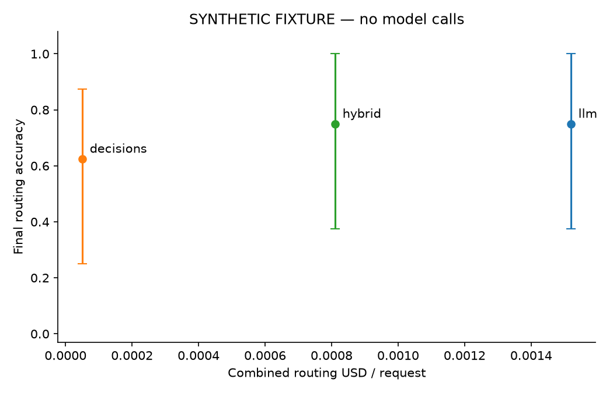

# Decision Router Lab

**When does an LLM fallback earn its extra call?** This Python project tests whether decision-model confidence selects *recoverable routing mistakes*: requests where a second model changes an incorrect next action into a correct one, enough to justify its combined cost and latency.

Arize already demonstrated decision tracing and confidence-gated fallback in a shopping agent. This project acknowledges [that experiment](https://arize.com/blog/ai-agent-tool-selection-decision-tracing/) and asks the next question: does uncertainty identify cases another model can actually rescue? A matched-rate random fallback control separates useful selection from simply buying additional inference.

**Current evidence status:** the implementation and offline checks are available. Live model access, measured development/test results, the selected gate, human label review, and live demo evidence are pending. The API key will be added later. No benchmark conclusion is claimed. `results/offline-example/` is a clearly marked **synthetic test fixture**, not a model experiment. The existing [take-home email](takehomeemail.md) and [research report](deep-research-report.md) are preserved.

## Reproduce locally without API spending

Run from the repository root on Python 3.12. The committed lock pins the environment.

```bash
uv python install 3.12
uv sync --locked --python 3.12
uv run router-lab validate-data
uv run pytest -q
uv run ruff check src scripts tests
uv run ruff format --check src scripts tests
uv run router-lab analyze --input results/offline-example/runs.jsonl --synthetic --output results/offline-example/analysis
```

The tests include an isolated Phoenix process, real dataset/experiment writes, and a server restart. They do not make paid model calls. The SDK protocol tests use a mock HTTP transport and verify automatic `DECISION` and `LLM` spans.

The offline analysis exports CSV/JSON tables and PNG figures. Its fixture has eight artificial questions, each repeated three times; it exercises the same analysis code used for the eventual 80-question held-out run. Every plot is marked synthetic. Reviewers can regenerate it without credentials or a Phoenix server.



## Start Phoenix and verify setup

Copy `.env.example` to `.env` if needed and add your own `OPENAI_API_KEY`. The ignored `.env` file is already created in this workspace. Set `PHOENIX_ENDPOINT` and `PHOENIX_COLLECTOR_ENDPOINT` to `http://localhost:6006`, and `PHOENIX_PROJECT_NAME` to `decision-router-lab`. A local Phoenix API key is unnecessary. If your shell defines `OPENAI_BASE_URL`, it takes effect; remove it to use the public OpenAI endpoint. The endpoint hash is recorded, and an endpoint change invalidates the live setup check and freeze.

In a separate terminal:

```bash
PHOENIX_WORKING_DIR="$PWD/.phoenix" uv run phoenix serve
```

Phoenix uses `.phoenix/phoenix.db` for SQLite persistence. Open [local Phoenix](http://localhost:6006). Then:

```bash
uv run --env-file .env router-lab smoke
uv run --env-file .env router-lab smoke --live
# Stop and restart Phoenix with the same PHOENIX_WORKING_DIR, then:
uv run --env-file .env router-lab smoke --check-persistence
uv run --env-file .env router-lab upload-data
```

`smoke` creates a two-row mocked dataset experiment with one correct and one incorrect grade. `--live` additionally calls each real model once, checks provider success and automatic span kinds, and saves `results/smoke.json`. The benchmark requires the live and restart checks. The smoke's deliberately mocked `DECISION`/`LLM` spans are named accordingly and are never research evidence. Experiment traces live in Phoenix's dedicated experiment projects; standalone smoke calls and demo traces use the configured application project.

Tracing is initialized once, before OpenAI clients, using `auto_instrument=True`; OpenAI is not instrumented a second time. Commands flush and shut down the provider. A supplemental span processor captures automatic provider span IDs while retaining Phoenix's exporter. Annotation writes tolerate Phoenix's asynchronous ingestion delay.

## Catalog and labels

The benchmark evaluates **one next routing action**, independently of argument extraction or final answers.

| Action | Routing distinction | Demo behavior |
|---|---|---|
| `search_docs` | Supported configuration, API usage, manuals, runbooks | Local documentation search |
| `search_code` | Actual implementation, source functions, code paths | Local snippet search |
| `lookup_issue` | Specific issue ID supplied | Stored issue record |
| `lookup_deployment` | Service and environment supplied | Stored deployment state |
| `lookup_test_results` | Specific test-run ID supplied | Stored result; never executes tests |
| `calculate` | Numeric operands and an allowed operation supplied | Validated arithmetic; no `eval` |
| `answer_directly` | General explanation needing no project facts | Skip tool execution |
| `ask_for_clarification` | Essential information absent or next action unresolved | Ask for missing information |

[benchmark.jsonl](data/benchmark.jsonl) contains 120 unique authored requests, 15 per action: five development and ten held-out per action. Categories are overlapping tags: straightforward, overlap, no-tool, clarification/missing information, compound with an explicit next step, distractor wording, and less-common tools. Label rationales are evaluator-only metadata. Only the request and fixed catalog enter routing calls; neither expected labels nor rationales are passed to a model. Demo judges see tool evidence but do not define ground truth.

Documentation requests differ from actual implementation requests. General conceptual questions can be answered directly. Missing essential identifiers require clarification; a supplied but absent fixture record requires an explicit not-found result. Compound requests require an explicit first step or a unique prerequisite. The balanced action mix does not establish production prevalence. Per-action results are mandatory; any future prevalence reweighting must be labeled synthetic.

Every label needs a real human audit before the benchmark runs. Review the request, action, rationale and paraphrase group, rewrite unresolved cases in `scripts/build_dataset.py`, regenerate with `uv run python scripts/build_dataset.py`, and record each audit:

```bash
uv run router-lab review-label --id search_docs-01 --reviewer 'Your name' --approve --note 'Requests documented retry configuration.'
```

Repeat for all 120 examples, reading each label. `data/review.jsonl` records reviewer identity, approval, timestamp and the exact example hash. Changed labels invalidate their reviews. Related paraphrases must share a split; the validator catches duplicate IDs/normalized requests, split/action counts and paraphrase leakage. Do not automate human approval.

## Run development, freeze, then evaluate held-out data

```bash
uv run --env-file .env router-lab benchmark --split dev
# Inspect development failures and annotate ambiguous cases in Phoenix.
uv run --env-file .env router-lab annotate --id search_docs-01 --policy decisions --repetition 1 --label docs_code_overlap --reviewer 'Your name' --note 'Describe the observed evidence.'
uv run --env-file .env router-lab select-gate
uv run --env-file .env router-lab benchmark --split test --frozen
uv run router-lab analyze
```

The two baselines run on development first: `40 × 3 × 2 = 240` calls before retries. The policies are:

1. **LLM-only:** `gpt-6.1-sol`, Responses API, strict structured output with the eight-action enum, low reasoning effort and a 512-token output budget.
2. **Decisions-only:** `gpt-6-luna`, one named `choice` question; records the selected action, full option distribution and separate confidence.
3. **Hybrid:** Decisions first; accept when `confidence >= threshold`, otherwise call the identical LLM baseline. Refusal, invalid action, malformed probability distribution or unusable confidence triggers a separately recorded operational fallback. An exhausted final failure remains a wrong route.

Gate selection replays the paired saved development outputs for thresholds `0.00, 0.05, …, 1.00`, plus explicit always-fallback (including confidence exactly one). It chooses the lowest-cost candidate matching or exceeding LLM-only development accuracy; ties use higher accuracy, then lower fallback rate. The random control matches discretionary escalation count within each repetition and retains mandatory operational fallbacks. A no-saving result recommends LLM-only and remains a valid finding.

`results/frozen.json` records dataset/catalog/prompt/evaluator/source/lock hashes, package versions, exact model configuration, endpoint hash, pricing assumptions, selected threshold, human-review hash, development-results hash, timestamp and Git commit/dirty status. Test runs refuse a missing or changed freeze. Gate selection refuses to retune after held-out outputs exist. Do not inspect held-out outputs before freezing.

Held-out execution is `80 × 3 × 2 = 480` baseline calls plus `240–480` hybrid calls, for approximately `960–1,200` core model calls overall, before smoke/demo/retries. The synchronous Phoenix runner processes one request at a time. Policy order rotates between repetitions; timestamps and order metadata are retained.

SDK retries are disabled. The application owns at most two transient retries per request with a 30-second request timeout. Authentication and invalid outputs are not retried. Retries, backoff, operational errors and unknown-usage charges remain visible. Local checkpoint keys include policy, example, repetition and configuration. Resume uses Phoenix's existing experiment and the local saved output, avoiding duplicate model calls and rows. Keep the results directory and global budget ledger; do not delete them to resume.

If prompts or descriptions change during development, use a new checkpoint directory (`router-lab --results-dir results/dev-v2 benchmark --split dev`) and rerun affected development evidence. The global `results/budget.jsonl` still covers all paid work. Finalize code/configuration before freezing.

## Cost, latency and uncertainty

The harness sums **every Decisions and fallback call**. Phoenix's normal LLM cost display excludes Decisions usage; custom `router.cost_usd` telemetry and the durable ledger are the combined accounting source. Cache reads and writes are subsets of input tokens and are not double-counted. The configured per-million-token rates were checked against the [Decisions guide](https://developers.openai.com/api/docs/guides/decisions), [Luna model page](https://developers.openai.com/api/docs/models/gpt-6-luna), and [Sol model page](https://developers.openai.com/api/docs/models/gpt-6.1-sol). Recheck pricing before a paid run. Current assumptions are standard short-context processing with no regional premium.

The budget ceiling is $50, with $5 reserved for the demo. Before a full run, the scheduler projects remaining cost from observed usage when available. Before every attempt it durably reserves a conservative estimate. Completed calls settle to token-based cost; timeouts, missing usage and interrupted requests keep estimated charges rather than becoming free. Reservations are safeguards, not provider-enforced billing caps. One process lock prevents concurrent paid commands. The demo and its semantic judges use the same ledger.

Measured routing latency includes sequential inference, retry backoff and local call journaling; grading, annotation/export waits and downstream demo answering occur afterward. Offline replay estimates are labeled separately and do not claim measured hybrid latency. Held-out hybrid latency is measured live.

`analyze` exports:

- `policy-summary.csv`, `summary.json`: accuracy, per-request combined cost, fallback rate, calls/request, p50/p95 latency, operational error and failure rates, usage-unknown counts.
- `per-action.csv`, `per-category.csv`, `rescue-regression.csv`, `overlap.csv`: detailed errors, rescues/regressions and the four-way baseline correctness overlap.
- `decision-signals.csv`, `confidence-bins.csv`: distinct decision confidence, maximum option probability and probability margin.
- `accuracy-cost.png`, `latency.png`, `reliability.png`, `margin.png`: exportable figures. Five confidence bins show observation counts; the final bin includes confidence 1.0.
- Multiclass Brier score (sum across eight classes, range 0–2), exploratory descriptive confidence calibration error and secondary signal analyses without test retuning.

Accuracy/cost comparisons use paired bootstrap resampling by **example**, retaining all repetitions. Latency-quantile intervals resample the same example clusters. There are 80 independent held-out questions, not 240. Random-control intervals describe seeded replay randomization, not bootstrap uncertainty. The primary result remains pending until live data exists; no synthetic numbers should enter a presentation as research findings.

## End-to-end developer-support demo

```bash
uv run --env-file .env router-lab demo
```

The demo uses the first development example for each action, under all three policies (24 traces). It extracts typed arguments with Sol, validates them with Pydantic, executes the deterministic local handler and generates an answer with the same model/prompt across policies. Direct-answer and clarification routes skip tools. Fixture misses return explicit not-found evidence. The trace exposes `AGENT → routing CHAIN → DECISION / fallback LLM`, plus argument-extraction `LLM`, `TOOL` and final-answer `LLM` siblings. The report's `run_tests` action is replaced by stored result lookup; ticket creation is deferred.

Routing correctness, argument validity, fixture lookup success, expected-fact presence, limited unsupported-claim flags and candidate answer success are recorded separately. Phoenix's prebuilt Tool Selection and Tool Invocation evaluators provide semantic second opinions through the same metered/retried Responses client. Their labels never overwrite benchmark labels. Invocation evaluation is inapplicable when no tool is executed. Heuristic checks cannot establish absence of unsupported claims; perform human answer review:

```bash
uv run --env-file .env router-lab review-demo --id lookup_issue-01 --policy hybrid --answer-success yes --unsupported-claims no --reviewer 'Your name' --note 'Checked against the issue fixture and tool trace.'
```

Show a real rescue only if one occurs. A correct final answer may conceal an incorrect initial decision; this implementation evaluates one next action and does not claim autonomous multi-step recovery.

## Evidence and walkthrough

Local checks pass: 59 tests, including real Phoenix persistence/splits/annotations, an 80-row mocked benchmark with resume, and the 24-case mocked demo; Ruff also passes. See [verification details](results/verification.json), [setup screenshots](docs/evidence/README.md), [the walkthrough checklist](docs/walkthrough.md) and [completion status](docs/status.md). Capture two or three explanatory live Phoenix traces and a short backup recording once measured runs exist. A local URL cannot be opened by interviewers. Exported figures, JSONL and screenshots belong with the submitted repository; `.phoenix/` and credentials remain local.

Three implementation lessons already supported by local checks are: preserve initial and final responsibility in separate annotations; include Decisions/cache usage in combined cost accounting; and treat repeated measurements as clusters of questions. Workload-specific developer lessons about confidence or fallback usefulness must wait for measured observations.

Optional future work from the report remains explicitly deferred: a second decision provider such as Clef; 8→16→32 tool stress tests; production prevalence sensitivity; tool-description/traffic drift; Phoenix MCP debugging; ticket writes; and voice, memory or autonomous multi-step agents. The strongest follow-up tests whether the selected gate survives changed descriptions or traffic.
