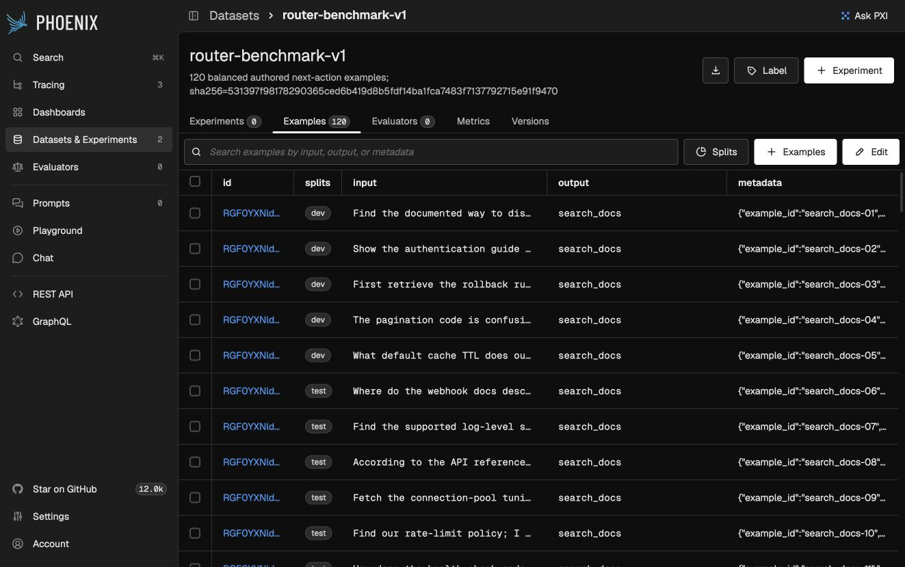
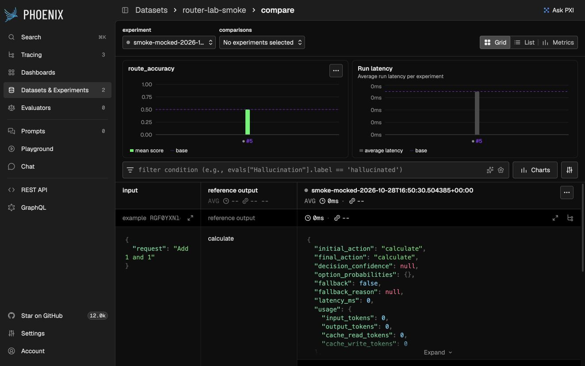
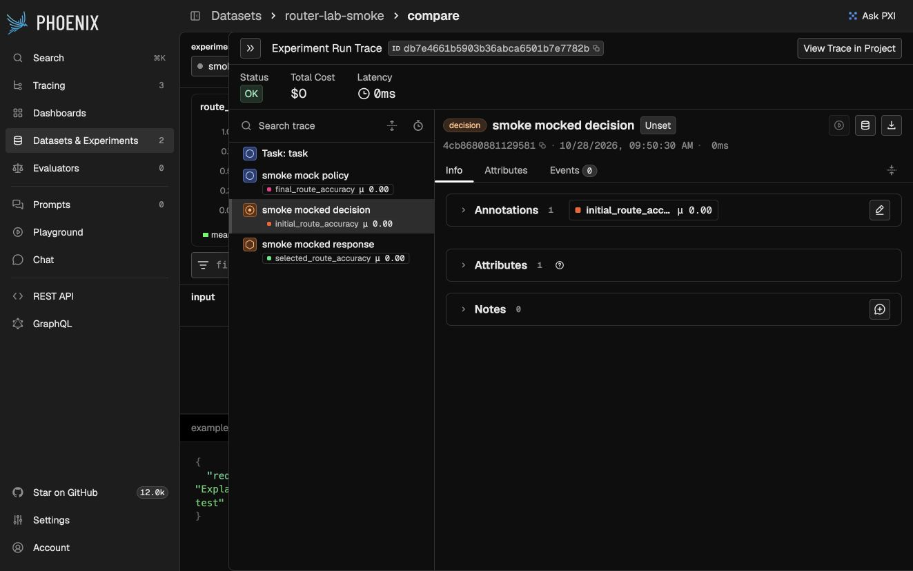

# Local setup evidence — no paid model calls

These screenshots were captured from the persistent local Phoenix instance on 2026-10-28.

- `phoenix-dataset.jpg`: the actual uploaded 120-example benchmark, split labels, expected outputs and structured metadata.
- `phoenix-mocked-experiment.jpg`: the two-row setup experiment, with deterministic correct and incorrect grades. Its zero usage/cost is a property of the mocked task, not measured provider performance.
- `phoenix-mocked-trace.jpg`: explicitly mocked provider spans and separate initial/selected/final responsibility annotations.

Replace or supplement these with explanatory **live** traces after development/freeze/test execution. They establish local product integration, not the research finding. The short research walkthrough recording remains pending live evidence.
