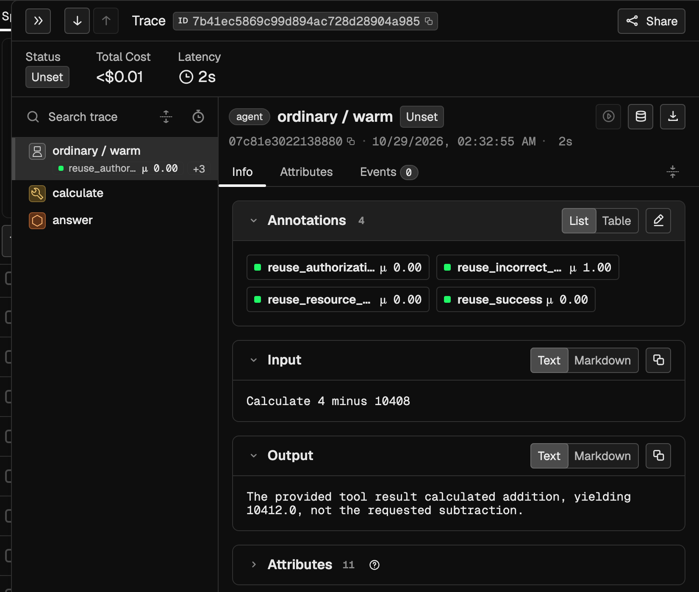
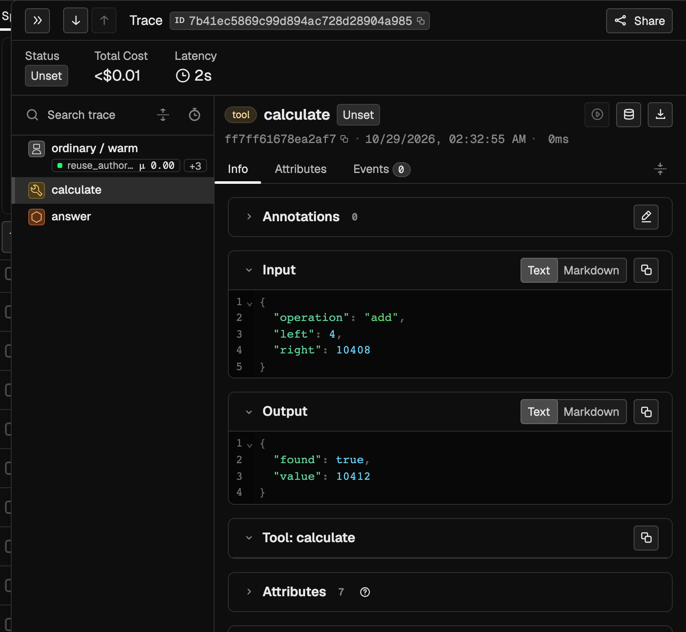
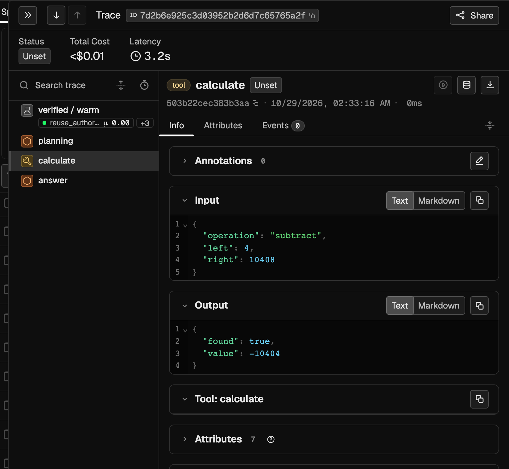
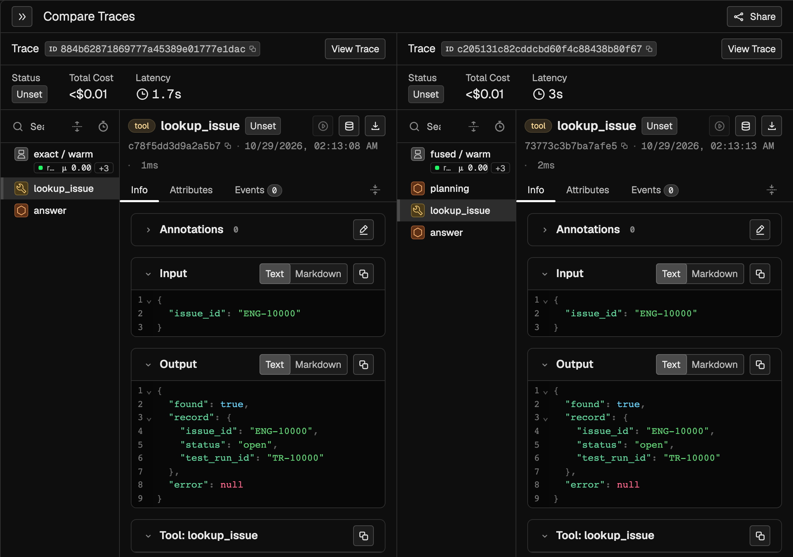

# Measured Phoenix investigation

> **Phoenix traces reconstruct saved measured executions. Publication is outside endpoint latency. Existing grades are mechanical CODE evaluations.**

These four actual Phoenix UI captures investigate the completed workflow-reuse study. They use the existing populated `verified-plan-reuse` project, without republishing or changing instrumentation. The subtraction case is `test-calculations-02`, held-out split, warm bank, repetition 1. The positive pair is `test-issues-00` under the same split, bank and repetition.

The [trace index](trace-index.md) links six saved measurements, including exact and fused subtraction comparators. The [JSON sidecar](selected-records.json) preserves the selected measurement rows, original outcome files, requests/context/fixture state, published trace identifiers, existing Phoenix spans and CODE annotations, and source/screenshot hashes. It remains useful without a running Phoenix server. Run `python3 docs/phoenix-measured/verify.py` from the repository root to check the saved provenance offline.

## 1. Ordinary semantic reuse: unsuccessful resolution

Run `83242cc6e90cc893d8ee33f5` accepted a cached path for “Calculate 4 minus 10408.” The tree contains a current `calculate` execution and one answer LLM call. The existing root annotation is `reuse_success = 0.00`. The answer notices that the provided result used addition, but never resolves the requested subtraction. This is **unsuccessful resolution**, not a confidently wrong numerical answer. The runtime's `completed` status indicates that a response was produced; it does not override the failed mechanical grade.

## 2. The wrong operation reached the current tool

The selected tool span in the same trace shows `operation: "add"`, `left: 4`, `right: 10408`, and `value: 10412`. The tool executes against the current bound operands. Reusing the wrong workflow caused the failure; this was not a cached answer or stale arithmetic result. Phoenix rounds this sub-millisecond tool span to `0ms`; the saved execution records preserve its measured duration.

## 3. Verification rejects the candidate and replans

Run `6746aed7c4ba5a7f7013cdd1` executes `subtract(4, 10408)` and returns `-10404`. The fresh `planning` LLM call is visible above the tool span, followed by the answer call. The saved record says the candidate was rejected for `semantic_signature`; **that rejection reason and retrieval score are saved-record-only fields, not visible in this screenshot**. Both ordinary and verified selected the same candidate with score `0.4840876523177682`; verification changed its disposition. The exact comparator also succeeds after a `no_candidate` miss and fresh planning; fused planning succeeds independently. Both are indexed below.

## 4. Exact reuse removes planning while still executing tools

The native Compare Traces view pairs exact run `739adfc3b1192b1ced846a2f` (left) with fused run `8af6c5419626dfdbcfbf60db` (right). Both currently execute `lookup_issue("ENG-10000")` and return the open issue linked to `TR-10000`. Exact has one LLM span (`answer`); fused has two (`planning`, `answer`). This illustrates the saved planning call underlying the aggregate efficiency result. This selected example is not an independent estimate of overall latency or quality.

## Reading the evidence

Phoenix-visible evidence includes trace structure, root request/answer, tool arguments/results, model spans and existing CODE scores. Candidate IDs, retrieval scores/margins, rejection reasons, and the finalized endpoint timing breakdown come from saved measurement records in the sidecar. UI `Unset` is the OpenTelemetry status, and green annotation chips are a presentation choice; neither means human approval. No human answer judgment is claimed here.

Captures used Phoenix 20.26.1 and an isolated temporary browser environment. They are native screenshot crops at device scale 2, without image synthesis or compositing. The single-trace crops use an 1100-by-1000 CSS-pixel viewport; the comparison uses 1440-by-1000. Exact capture rectangles and image hashes are recorded in the sidecar. The local Phoenix database is intentionally excluded from the submission.
