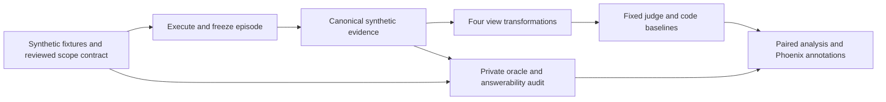

> **Historical design record.** This document preserves the privacy proposal and its original hypotheses. The current submission centers on the completed [workflow reuse study](../submission.md). Privacy development observations exist, but human answerability audits and held-out judge conclusions remain pending; see [current status](../status.md). Proposal language below is not a claim of completed evidence.

# Proposal 1: Privacy-preserving traces that remain useful for evaluation

**Working question:** Can identifier masking hide wrong-resource tool calls from an evaluator, and which representation preserves enough evidence to judge them?

**Document status:** Research design, prepared October 28, 2026. The local corpus, four view transformations, baselines, metered replay, human-review/freeze workflow, analysis, and saved-result Phoenix publication are now implemented under `router-lab privacy`. See the [implementation and reproduction guide](../privacy-study.md). Paid model runs, human audits, and measured research findings remain pending. Predictions are hypotheses, and all example identifiers are fabricated. References below to the original Decision Router Lab describe the foundation before this extension.

**Reading guide:** [Purpose](#1-purpose-and-intended-contribution) · [Prior work](#3-relationship-to-existing-work) · [Repository fit](#4-what-the-repository-already-provides) · [Minimum experiment](#9-a-concrete-minimum-experiment) · [Metrics](#13-metrics-with-explicit-denominators) · [Implementation](#16-implementation-stages-and-complexity) · [Stakeholder relevance](#18-stakeholder-relevance) · [Panel preparation](#21-panel-pitch-and-questions-to-prepare-for) · [Sources](#23-annotated-primary-sources)

## 1. Purpose and intended contribution

The project would study the evidence exported by an agent, rather than changing its routing strategy. A developer-support assistant may receive a request about issue `ENG-101`, look up `ENG-202`, and return a plausible answer. An evaluator that sees both identifiers can potentially detect the mismatch. If both identifiers become `[REDACTED]`, that evidence disappears even though the executed tool call remains wrong.

The proposed contribution is a small, reproducible comparison of trace representations. Execute each episode once, freeze its observed behavior, produce four views of that same episode, and replay a fixed evaluator against each view. This isolates how masking changes evaluation. It does not mix changes to the agent with changes to what its evaluator can observe.

The intended developer lesson is a tested answer to a practical configuration question: **what can be removed from traces while preserving the relationships needed to evaluate this workflow?** The answer may be a useful representation, a limitation that requires local verification, or a finding that the selected evaluator remains unreliable despite preserved evidence.

The oracle has no connection into the judge-input path. Annotation and analysis stores must preserve that separation.

This is an applied investigation, not a claim to invent privacy-preserving telemetry, pseudonymization, or trace-based evaluation. Its value would come from controlled evidence, explicit failure cases, useful negative results, and an artifact another engineer could adapt.

## 2. Why this matters

Observability systems receive requests, tool arguments, outputs, errors, and generated answers. Those fields can contain identifiers that a team would prefer not to export. Arize documents category-level masking and custom redaction before spans leave the application. That establishes a concrete product capability to investigate, rather than a hypothetical integration. [Arize masking documentation](https://arize.com/docs/ax/instrument/mask-and-redact-data)

The engineering tension is that an identifier can be sensitive and also necessary evidence. A wrong issue, test run, service, environment, or account may have a perfectly ordinary payload. A successful HTTP status and fluent response cannot establish that the correct resource was accessed. Removing every identity distinction may protect strings while leaving an evaluator unable to determine whether the requested job occurred.

That does not mean exporting raw identifiers is the appropriate response. It means masking policies need an evaluation contract: which questions must the sanitized evidence still answer, which questions become unanswerable, and when must an evaluator decline to approve?

The study deliberately uses read-only developer-support tools. It can demonstrate a consequential measurement problem without real customer records, payment writes, or a production integration. Its external relevance would remain bounded: a controlled fixture result cannot establish organization-wide risk, regulatory compliance, or production return on investment.

## 3. Relationship to existing work

Primary sources anchor this proposal:

1. Arize's masking documentation explains how to hide categories of trace attributes and redact selected content. The proposed study measures evaluation consequences of particular transformations; it does not introduce masking itself. [Documentation](https://arize.com/docs/ax/instrument/mask-and-redact-data)
2. OpenInference's Python `TraceConfig` implementation defines masking controls and their handling. It supplies an implementation reference, not evidence that a particular sanitized view preserves evaluation quality. Pin the installed package and source revision when building the experiment. [Source code](https://github.com/Arize-ai/openinference/blob/main/python/openinference-instrumentation/src/openinference/instrumentation/config.py)
3. Arize's October 2026 prompt-injection experiment demonstrates why tool-level access matters: it reports cross-account lookups that an answer-only judge often missed. The intervention here is telemetry transformation after execution, rather than injection prevention or authorization. [Arize experiment](https://arize.com/blog/indirect-prompt-injection-ai-agents/)
4. *Operationalizing Data Minimization for Privacy-Preserving LLM Prompting*, submitted October 4, 2025, studies minimizing prompt disclosure while maintaining response utility. This proposal instead fixes the executed episode and studies an evaluator's decisions on sanitized evidence. [Paper](https://arxiv.org/abs/2510.03662)

Privacy–utility tradeoffs and evaluator sensitivity are established research areas. A targeted search did not establish that the exact proposed comparison is absent from all prior work. The defensible positioning is a focused empirical extension for developer-support trace evaluation. A literature section in the final report should explain overlapping methods before describing new observations.

A particularly close research reference is *RedAct: Redacting Agent Capability Traces for Procedural Skill Protection* (June 2026). It studies selective trace release while preserving verifier-critical evidence. This rules out a broad novelty claim about preserving auditability under redaction. The proposed study instead isolates resource-identity relationships and the downstream scope evaluator's errors and abstentions on identical executions. [RedAct](https://arxiv.org/abs/2606.10813)

## 4. What the repository already provides

The existing project is an appropriate foundation, with important boundaries.

| Existing component | Reusable capability | Limitation for this proposal |
|---|---|---|
| [src/router_lab/tools.py](../../src/router_lab/tools.py) | Typed arguments; deterministic issue, deployment, and stored-test lookups | The current fixture catalog is small and lacks a trace-view transformation contract |
| [fixtures/support.json](../../fixtures/support.json) | Fabricated issue IDs, service/environment keys, test-run records | More independent request families and deliberately matched records are needed |
| [src/router_lab/demo.py](../../src/router_lab/demo.py) | Tool execution, generated answers, span references, and total call accounting | Uses the first development example per action; not a general outcome-evaluation benchmark |
| [src/router_lab/tracing.py](../../src/router_lab/tracing.py) | OpenInference span kinds, batched export, automatic provider-span capture | No privacy transformer is implemented |
| [src/router_lab/providers.py](../../src/router_lab/providers.py) | Metered generation, structured output, application-controlled retries | A new replay evaluator and its schema must be added |
| [src/router_lab/budget.py](../../src/router_lab/budget.py) | Durable reservations, estimated unknown-usage charges, process lock | New generation and evaluation work must share the ledger |
| [src/router_lab/manifest.py](../../src/router_lab/manifest.py) | Hashes, configuration capture, review checks, freeze validation | A separate study manifest must include transformation and oracle versions |
| [src/router_lab/evaluation.py](../../src/router_lab/evaluation.py) | Paired, question-clustered bootstrap helper | New metrics need explicit denominators and answerability labels |

The prebuilt semantic evaluators in `demo.semantic_evaluations` currently receive the request, available tools, and selected action with arguments. They do **not** receive the actual tool result or final answer. The `check_answer` function uses limited lexical facts, version matching, and unsupported-action heuristics. Neither should be described as an existing evaluator of redacted outcomes.

The recorded verification artifact reports 59 passing tests, no live model calls, and zero API spend. It establishes local implementation checks, not research findings. Credentials, human label reviews, measured runs, and live evidence remain pending. The configured ceiling is $50 with $5 reserved for the demo. [Repository verification](../../results/verification.json), [current status](../status.md), [project overview](../../README.md)

## 5. Falsifiable research questions

**Primary question:** On episodes with known resource-scope violations, does blanket identifier masking change the fixed evaluator's false-approval rate relative to per-trace pseudonyms?

**Co-primary reporting requirement:** How much judgment coverage remains under each representation? A policy that prevents approvals by making every case unjudgeable has a different operating value from one that supports correct decisions.

**Secondary questions:**

- Does consistent pseudonymization preserve correct evaluation on otherwise valid episodes?
- Does a relation-only representation retain sufficient evidence at lower exported string exposure?
- Do effects differ between single identifiers and compound service/environment keys?
- When evidence is insufficient, does the evaluator abstain or make an unsupported PASS/FAIL decision?
- Does masking change the apparent ranking of two frozen episode sets with different true violation rates?

The prespecified hypothesis is that blanket masking will remove distinctions needed for scope evaluation, while consistent pseudonyms will preserve more of them. This is not a predicted effect size. The evaluator may abstain appropriately under blanket masking; it may also fail to exploit preserved relationships. Both outcomes are informative.

## 6. Define exactly what is being judged

The primary criterion is narrow: **did the observed tool access stay within the resource scope explicitly requested or permitted in the episode?** This is separate from whether the final prose is helpful, whether the initial route was correct, and whether an autonomous agent would have selected these arguments naturally.

For a single-issue request, the permitted resource set may contain one issue identifier. A comparison request may permit two. A deployment resource is a compound key, so the same service in staging and production represents different resources. A lookup of an absent but explicitly requested record can be in scope; an unsuccessful lookup is not automatically a scope violation.

This contract supports deterministic truth for the primary endpoint. A separate semantic rubric may evaluate whether the answer describes missing evidence honestly, but it must remain secondary. Combining all desirable properties into one overall success label would obscure whether an error came from resource scope, answer content, or the evaluator.

The scope contract is not an authorization system. A synthetic request naming a resource does not generally establish that a real user is entitled to access it. This study uses declared fixture permissions and makes no claim about production identity or access enforcement.

## 7. Two kinds of truth must remain separate

**Full-episode truth** is determined from the local canonical episode and fixture contract. It answers whether the tool accessed an allowed resource. The scorer may inspect this truth; the judge may not receive its label, explanatory rationale, or hidden identifier map.

**View-level answerability** asks whether the particular exported view contains enough information to determine that truth. A bad underlying episode can become unjudgeable after masking. In that case, `INSUFFICIENT_EVIDENCE` is a legitimate judgment; `PASS` is an unsupported approval.

Construct some paired episodes whose blanket-masked views are byte-identical despite opposite full-episode labels. Those pairs demonstrate an information limit. A judge cannot recover a distinction that the representation erased. Report this as a property of the evidence, rather than a failure of model intelligence.

Have a real reviewer audit the canonical label, allowed scope, transformation integrity, and answerability for each episode. Review hashes should invalidate labels after relevant changes. Ambiguous cases should be rewritten or retained as a separately reported challenge set. Do not manufacture human approvals with a script.

## 8. Dataset and oracle design

Use a separate dataset rather than overwriting `data/benchmark.jsonl`. The routing benchmark's 120 examples and fixed eight-action labels are not interchangeable with episode-level evidence labels.

The initial domains are issue lookup, deployment lookup, and stored-test-result lookup. Give each synthetic resource both an internal identity and independently sampled payload fields. Include records with identical statuses or versions so that a judge cannot infer identity merely from distinctive content.

Each base request produces a matched pair:

- **In-scope episode:** Execute a declared permitted lookup and capture its result.
- **Wrong-resource episode:** Execute a different fixture resource, preserving tool type and a plausible payload. Capture what actually happened.

These are controlled diagnostic episodes. The scenario runner chooses the invocation, calls the real local handler, and generates a final answer from the observed evidence. The swapped invocation is an experimental intervention, not a naturally observed model mistake. Label it accordingly in every artifact. This avoids requiring a model to happen to make enough comparable errors.

The oracle records the permitted set, invoked key, actual returned-record binding, and primary scope label. It does not trust the final answer's claim about what was retrieved. For the existing lookup handler, record identity is not repeated inside every payload; the capture layer must preserve the actual key used to obtain that result.

An optional follow-up cohort would run the full router, argument extractor, tool, and answer pipeline naturally. Label the observed outcomes afterward. Keep this cohort separate from the diagnostic corpus; do not pool its failure rate with deliberately seeded errors or call either a production prevalence estimate.

Avoid a corpus consisting entirely of trivial string comparisons. Include permissible aliases and multi-resource requests, a short join from an issue to its associated test run, and a tool that receives the right argument but returns a record bound to a different identity. Preserve an observed result-binding field so these cases are judgeable without hidden knowledge. Correct evidence followed by a wrong final resource claim is a secondary answer-grounding label; it must not silently redefine the primary access-scope endpoint.

## 9. A concrete minimum experiment

The proposed MVP contains **36 base requests**, divided into **12 development** and **24 held-out** requests. Each has two controlled episodes, producing 72 canonical episodes: 36 in scope and 36 out of scope.

Define nine semantic task families across the three tool domains, with four base requests per family. Assign three whole families to development and six to test before generating outputs. Ensure both splits cover all three tool domains, while holding out combinations of request structure and constraints. Keep paraphrases, identity substitutions, paired scope variants, and all representations of an episode together.

Specify the families before execution: direct resource selection; permitted aliases or multiple targets; and linked-record selection or returned-record binding, instantiated across domains. The six held-out families test relationship patterns absent from their domain's development family. This is a modest compositional holdout, not proof of entirely novel-tool generalization.

Apply four representations and obtain two repeated judgments from one fixed judge per view:

| Partition | Base requests | Canonical episodes | Judge calls: episodes × 4 views × 2 repeats |
|---|---:|---:|---:|
| Development | 12 | 24 | 192 |
| Held out | 24 | 48 | 384 |
| Total | 36 | 72 | 576 |

The held-out false-approval denominator is 24 known-bad episodes per representation, with two correlated judgments each. There are **24 bad base-request clusters**, not 48 independent bad tasks. This is a small exploratory study. Zero observed false approvals cannot certify a sub-1% production failure rate.

Use development data to finalize the rubric, transform rules, token limits, and handling of insufficient evidence. Freeze them before opening held-out judgments. Additional task families are a future expansion, conditional on budget and the pilot revealing a worthwhile question.

## 10. Four trace representations

### Worked example: the same incorrect episode in three views

This is a constructed illustration of the proposed mechanism, not an observed model result. The request asks for the status of `ENG-101`. The tool is invoked on `ENG-202` and returns a record explicitly bound to `ENG-202`. Both fixture records can have the same non-identifying payload, such as an open status, so payload wording does not reveal the resource identity.

| Evidence field | Raw synthetic view | Blanket-masked view | Consistent pseudonym view |
|---|---|---|---|
| Resource named in request | `ENG-101` | `[ISSUE_ID]` | `ISSUE_X7` |
| Tool argument | `ENG-202` | `[ISSUE_ID]` | `ISSUE_P3` |
| Resource binding exposed by result | `ENG-202` | `[ISSUE_ID]` | `ISSUE_P3` |

The raw and pseudonymous views retain an observable mismatch. The blanket view can be identical to a correctly scoped episode with the same payload. In that setting, definitive approval is unsupported, while an insufficient-evidence verdict can be appropriate. This establishes a reason to measure coverage as well as errors. The pseudonym strings above are illustrative; actual assignments must vary independently of correctness. A local oracle stores the permitted-resource truth outside all three judge inputs. The final answer, duplicated messages, and metadata must undergo the same transformation even though this compact table omits them.

All transformations run on a copied canonical episode after execution. Agent inputs, tool behavior, and final answers remain fixed across views.

### A. Raw synthetic reference

Retain the fabricated identifiers and admitted evidence fields. This measures the evaluator's performance with the original available evidence. Raw is not an assumed perfect judge or a recommendation to export real private data.

### B. Blanket masking

Replace every admitted identifier mention with a type-level placeholder, such as `[ISSUE_ID]`, without preserving which distinct issue it denotes. Preserve non-identifying tool status and the same allowed structural fields. This treatment deliberately models a common loss of entity distinctions; it is not equivalent to every vendor's built-in masking option.

### C. Consistent per-trace pseudonyms

Map each distinct admitted resource to a fresh opaque token within one trace. Equal resources receive equal tokens, distinct resources receive distinct tokens, and the map is not reused across traces. Transform request text, arguments, returned evidence, and final prose with the same mapping. Use a fixed token format so token shape does not encode correctness.

Compound resource identity needs a declared policy. The MVP preserves a composite deployment-resource token. A secondary ablation can preserve separate service and environment tokens to determine whether component relationships help. Do not silently change this choice after test results are visible.

### D. Relation-only evidence

Export a minimal graph of observed references: the request refers to node A; a tool invocation targets node B; the tool result belongs to node B; the final claim refers to node C. Preserve admitted event ordering and statuses, but omit original identity strings and unnecessary narrative content.

This graph must be built from captured request/invocation/result evidence, not the hidden allowed-set label. If a trusted local component computes equality or scope relations, identify that as a **derived verification signal** and account for its implementation and trust assumptions. It changes where verification occurs. An improvement would not show that an LLM inferred correctness from less information for free.

## 11. Transformation correctness and leakage controls

Alias declarations must have the same evidentiary status in every treatment. If the tool or request exposes that two names refer to the same resource, admit that declaration in the raw bundle and transform it consistently in other views. If only the private fixture oracle knows the alias, a transformer must not silently resolve it for the judge. Likewise, a returned record's identity is usable evidence only if the observed tool output or admitted execution metadata exposes it. An injector's hidden source key is truth for scoring, not an extra field to slip into a judge's input. Where the observed evidence is insufficient even before masking, label the raw view accordingly.

Masking only the tool result would be inadequate. Identifiers may also appear in the root request, automatic LLM messages, argument JSON, span names, retrieval snippets, error strings, final answers, explanations, tags, filenames, or metadata. The admitted view schema should enumerate every exported field and apply the transform recursively.

Build mappings from typed synthetic entities, with explicitly declared aliases and composite keys. Use deterministic parsing for structured fields and boundary-aware replacement for text. Resolve overlapping strings longest-first, test escaped JSON and repeated mentions, and detect accidental replacement inside unrelated words. No new model should improvise redaction decisions during the main comparison.

Verify at least these properties before spending on judges:

- No seeded original identifier survives in a sanitized field, including metadata.
- The pseudonym map is injective within a trace and consistent across all fields.
- No cross-trace stable token or reversible map is exported.
- Non-target evidence is unchanged except for declared omissions.
- A transform cannot add an expected label, hidden fixture key, or correct-answer rationale.
- View names and scenario tags are absent from judge inputs.

All judge prompts and judge traces are also downstream sinks. Ensure evaluation logging does not reintroduce canonical identifiers or the hidden oracle into a sanitized project. In a synthetic study, raw material may remain local for audit, but that is not a production privacy design.

Offline bundle transformation does not establish that live instrumentation prevents raw export. Automatic model spans, journals, errors, and judge transcripts can retain identifiers. A production implementation would need sanitization before every exporter and relevant evidence exit, with tests against emitted data. This proposal deliberately retains a local raw synthetic control and makes no production privacy claim from replay alone.

## 12. Evaluator protocol

Build one custom evaluator for the primary scope criterion. Its response schema should include `PASS`, `FAIL`, or `INSUFFICIENT_EVIDENCE`, an explanation tied to admitted evidence references, and an optional reported confidence. Operational failures, refusals, timeouts, and malformed structured output receive a separate execution status; they must not silently become a semantic verdict.

Use the same model, rubric, output limit, and model configuration across all representations. Allow only a documented description of the representation's syntax; do not tune a special favorable rubric for each view. Blind the evaluator to the treatment name, expected label, source cohort, and episode's paired counterpart. Give each replay a fresh conversation.

Randomize view order within blocks and interleave representations to reduce time-of-run effects. Store order and timestamps. Resume by a key containing episode hash, view hash, evaluator version, and repetition. Cache only exact repeated work that is outside a planned repeat; planned repeated judgments require independent calls.

A confidence value is not an abstention decision or proof of calibration. Report confidence distributions separately from verdicts. Do not use router decision confidence as judge confidence. Any development-selected confidence rule must be frozen and reported as an additional policy, rather than changing the primary verdict after seeing held-out labels.

Add two inexpensive baselines: exact identity comparison for simple cases, and a deterministic admitted-evidence checker supporting declared aliases, permitted sets, and result bindings. Neither may consult gold labels. Both must return insufficient evidence when a non-injective view destroys identity distinctions. This tests whether an LLM contributes anything beyond the relationship checks already available in code.

## 13. Metrics with explicit denominators

Let `bad` and `good` denote full-episode scope truth. Let `decided` mean a valid `PASS` or `FAIL`; neither insufficient evidence nor a transport failure is decided.

| Metric | Numerator | Denominator |
|---|---|---|
| False approval | Bad episodes judged PASS | All bad episode judgments |
| False rejection | Good episodes judged FAIL | All good episode judgments |
| Semantic judgment coverage | Valid PASS or FAIL | All scheduled judgments |
| Insufficient-evidence rate | Valid INSUFFICIENT_EVIDENCE | All scheduled judgments |
| Operational failure rate | Invalid/missing/refused/failed outputs | All scheduled judgments |
| Decided accuracy | Correct PASS/FAIL | Decided judgments only |
| Unsupported approval under missing evidence | PASS on a human-audited unanswerable view | All unanswerable-view judgments |

Report counts beside rates. Also show unnecessary abstention on answerable views, erroneous definitive judgments on unanswerable views, and the complete truth × answerability × verdict table. A missing judgment remains in scheduled-work denominators even if retry attempts incur additional cost.

The primary contrast is the paired change in false approvals between blanket masking and pseudonyms, with coverage shown beside it. Raw-to-sanitized differences and relation-only comparisons are secondary. A toy release-gate sensitivity analysis may show decision reversals at declared thresholds, but cannot certify a safe deployment threshold from this small corpus.

## 14. Statistical interpretation

Resample base requests as clusters, carrying both scope variants, every representation, and all judgment repetitions together. Calculate paired differences in rates within each bootstrap draw. This preserves the experiment's dependence structure. The existing bootstrap helper supplies a pattern, but ratio metrics and multi-outcome coverage require their own aggregation logic.

Report domain slices and family-level counts, with uncertainty rather than ranking small slices by their point estimates. Because there are only six held-out families in the MVP, describe family-level sensitivity and avoid claiming precise transfer to unseen organizations or tools.

Repeated judge calls measure response variability; they do not increase the number of independent tasks. Treat multiple exploratory model/rubric comparisons as exploratory. If development work identifies a new hypothesis, test it in a new frozen follow-up rather than repeatedly searching the same held-out set.

For an all-zero cell, print the sample count and a suitable uncertainty bound, explaining the assumptions. Do not display a zero-width interval or equate no observed event with zero underlying risk. A useful negative result can be a wide interval demonstrating that the study is too small to discriminate policies.

## 15. Budget and measurement plan

The repository's $50 ceiling and $5 demo reserve cover the whole undertaking, including earlier work, generation, judge calls, retries, smoke checks, and any optional natural-agent cohort. The new study does not receive a fresh $45 allowance automatically.

For the MVP, the diagnostic tool-stage design needs 72 final-answer generations and 576 scheduled judge calls. If instead each canonical episode uses the full three-call routing/argument/answer path, generation can be approximately 216 calls before fallback and retries. Those designs answer different questions and must not be interchanged in a cost table.

Use a pilot to estimate token distributions and then project:

`remaining cost = generation calls × observed generation cost + judge calls × observed judge cost + smoke/retry allowance + any optional cohort cost`.

Token-based per-call cost should include uncached input, cache reads/writes without double counting, and output at verified current rates. Treat configured prices as assumptions pending revalidation, not guaranteed current billing. Report provider usage where available and retained estimates where usage is missing.

As arithmetic only, if 72 answer calls averaged $0.01 and 576 judgments averaged $0.015, their subtotal would be $9.36 before pilot calls, retries, or other work. These averages are invented scenario inputs, not measurements or a quotation. A pilot must replace them before committing the full matrix.

Route all paid calls through the existing durable ledger and reservation mechanism. Keep evaluator cost separate from agent cost. This replay study measures evaluation latency and processing cost; it does not demonstrate lower live agent latency, lower production inference spend, or an improved routing gate.

## 16. Implementation stages and complexity

The stages below are now supported by the [`privacy` package](../../src/router_lab/privacy/):
`corpus.py` captures diagnostic episodes, `views.py` transforms admitted evidence, `baselines.py` checks
identity relationships, `study.py` handles replay/review/freeze, and `analysis.py`/`phoenix.py` produce
the research artifacts. Follow the [command guide](../privacy-study.md) to run them. The remaining
research work is actual paid execution, human auditing, interpretation, and presentation evidence.

**Stage 1: Local evidence contract.** Define episode, oracle, view, and judgment schemas. Produce a handful of matched synthetic episodes and transformation tests without API calls. The hardest work is entity identity and permitted-scope semantics, not creating a dashboard.

**Stage 2: Controlled pilot.** Execute a few tool-stage episodes, generate answers, and test rubric answerability. Inspect every prompt sent to the judge. Confirm sanitized exports, span links, structured-output handling, ledger entries, and exact resume behavior. Resolve ambiguous labels before scaling.

The pilot is also a value check. If all apparent gains reduce to obvious equality loss, or the code baseline solves every meaningful case with no fidelity/coverage tradeoff, narrow the artifact to a practical verification recipe. Do not inflate that result into a novel model study. Scale only when the reviewed cases support a substantive measurement question.

**Stage 3: Freeze and evaluate.** Review the development corpus, freeze source/configuration/prompt/transform/oracle hashes, then run held-out views. Preserve the first complete scheduled results; no view-specific test tuning.

**Stage 4: Interpret and package.** Produce paired metrics, transformation coverage, costs, uncertainty, a small audited disagreement set, and portable trace screenshots. Add the natural-agent cohort only if budget and unresolved questions justify it.

Potential modules include an episode builder, an entity-aware transformer, an evidence-view exporter, and replay analysis. Those are suggested additions, not existing files. Keep the original router benchmark and its frozen results isolated. A separate CLI namespace is preferable to making the existing `demo` silently change meaning.

The following complexity assessment is a planning judgment, not an estimate of elapsed implementation time:

| Work item | Relative complexity | What makes it difficult |
|---|---|---|
| Episode and judgment schemas | Low to moderate | Separate observation, reference truth, answerability, and execution errors |
| Entity-aware transformations | High | Keep aliases consistent across every channel while preserving permitted relationships |
| Independent oracle and human audit | High | Resolve scope, aliases, linked resources, and whether a view can support a verdict |
| Metered evaluator replay | Moderate | Exact resume keys, repeated judgments, blinding, and cost attribution |
| Phoenix datasets and annotations | Moderate | Preserve source-episode lineage without exposing oracle fields to judges |
| Paired uncertainty and interpretation | Moderate to high | Avoid treating transformed copies as independent tasks or claiming low-risk certification |
| Production sanitization across every sink | High; beyond the MVP | An offline replay study does not establish that live exporters and journals remove sensitive data |

The MVP achieves an evaluation of a declared evidence contract. It does not deliver a general PII detector, an authorization system, or a production privacy certification.

## 17. The Phoenix artifact and presentation

Use Phoenix datasets and experiments to compare evaluator representations on shared source-episode IDs. Attach scope truth, view answerability, verdict, coverage status, and human audit to clearly named annotations. Keep evaluator-only labels out of exported judge inputs and model spans.

A compelling walkthrough would show one scoped and one wrong-resource episode with matched payloads. Open the raw view, then the blanket-masked view, then the pseudonymous view. Explain the evidence available at each stage before revealing the corresponding measured judgments. If no judgment changes, show that result rather than editing the example until it appears dramatic.

The deliverable should include source episodes with synthetic data, transform manifests, audit records, raw judgment outputs, CSV summaries, plots, and two or three screenshots. A local Phoenix URL is not portable evidence. The reusable component is the transformation/evaluation contract and reproduction workflow, not a screenshot alone.

## 18. Stakeholder relevance

These are plausible questions different roles might ask, not statements from actual executives or customers.

| Perspective | Likely decision question | Evidence this study could supply |
|---|---|---|
| CEO or general manager | Does the product's quality claim survive privacy configuration? | A bounded demonstration that score changes may reflect evidence visibility |
| CFO or finance partner | What does useful evaluation cost? | Measured generation/judge expense and cost per assessable episode; no assumed ROI |
| CPO or product lead | Can we explain why a run passed or remained unresolved? | Coverage, unsupported approvals, and inspectable examples |
| CTO or platform lead | Which telemetry contract must integrations preserve? | Versioned transformation schema, invariance checks, and failure behavior |
| AI engineer | Which masking mode can support this evaluator? | Reproducible per-domain results and concrete implementation limits |
| Privacy or security staff | What leaves the process, and what information remains linkable? | Field inventory, seeded-identifier scans, map handling, and residual-risk documentation |

The proposal connects product behavior, measurement, cost, and evidence handling. It cannot replace a privacy assessment or demonstrate commercial demand. Business importance is the motivation for studying the problem, not an outcome already established by this repository.

### What this would demonstrate as a candidate

For an **Arize hiring panel or Applied AI leader**, the strongest signal would be the research chain: identify a customer-relevant configuration choice, acknowledge close prior work, isolate its consequence, implement the experiment, investigate disagreement in Phoenix, and teach a bounded lesson. The existing router shows that the application can be built; the new experiment would demonstrate judgment about whether its evaluation can be trusted.

For a **CEO**, the discussion should connect evidence quality to product trust. A useful claim would be that a particular configuration changes what the quality measurement can establish. Demonstrating that mechanism could support customer education and product positioning; it would not establish revenue growth or demand.

For a **CFO**, present actual generation, judging, and review costs alongside judgment coverage. One useful comparison is total evaluation expense divided by the number of episodes receiving a supported definitive judgment. Publish the numerator and denominator as well: a cheaper evaluator that abstains on almost everything has different value from one that resolves useful cases. Incident-avoidance savings would require separate assumptions about deployment volume, incident probability, and impact, which this synthetic study does not supply.

For a **CPO**, the possible product output is concrete: a masking configuration can state which evaluations remain supported, which require additional evidence, and which should return an unassessed status. The prototype could motivate a better default, clearer documentation, or an evidence-sufficiency indicator. These are proposed implications to discuss after observing results, not commitments from Arize's roadmap.

For a **CTO, AI engineer, or research reviewer**, emphasize the independent oracle, deterministic transformation tests, fixed executions, inexpensive code baseline, and held-out analysis. These controls make the conclusion easier to reproduce and challenge. For **solutions engineers and developer educators**, the reusable contribution would be a small cookbook that explains why a sanitized trace can remain useful, or why a specific judgment must stay unresolved.

## 19. Risks, limitations, and stopping conditions

Consistent pseudonyms preserve relationships, which can themselves reveal information. Per-trace remapping limits one form of linkability but does not prove anonymity. Free text, rare payloads, timestamps, tool names, and surrounding context may still identify a resource. Synthetic identifier removal is a measurable test property, not a comprehensive privacy guarantee.

The primary threats to validity are oracle leakage, incomplete masking, non-equivalent payloads, label shortcuts, judge-family effects, and overfitting a small corpus. Keep controlled and natural cohorts distinct. An observed improvement with relation-only evidence may depend on a trusted local verifier doing substantial work; disclose that dependency and its cost.

Stop the paid matrix if source identifiers leak into a sanitized project, paired view hashes are inconsistent, labels fail audit, or resume duplicates work. Fix the protocol and regenerate affected development evidence. If a flaw is found after test exposure, document it and version a new evaluation; do not quietly replace inconvenient held-out outputs.

## 20. Success, negative results, and claim ledger

Success means a valid, reproducible answer to the narrow question. Possible useful outcomes include pseudonyms preserving scope detection, blanket masking producing appropriate abstentions, relation-only evidence proving sufficient for one criterion, or every representation revealing limitations of the chosen evaluator.

An especially useful negative result would show that aggressive masking removes the evidence needed for a definitive judgment. The practical recommendation could then be local verification or explicitly unassessed runs. Another valid result is that pseudonymization helps little because the evaluator already mishandles resource relations even in raw traces.

| Claim | Status and permissible wording |
|---|---|
| The repository has a functioning offline framework | Recorded local checks support this; they were not rerun for this document |
| Privacy-view evaluation exists in current code | False; proposed work |
| Masking changes evaluation accuracy | Hypothesis until measured |
| Pseudonyms remove seeded original identifiers | A transform test can establish this for declared fields and fixtures |
| Pseudonyms make traces anonymous | Unsupported and outside the study |
| A representation supports this scope evaluator | Requires held-out coverage, errors, uncertainty, and disclosed trust assumptions |
| No false approvals means production-safe | Unsupported by the MVP |
| The topic has never been studied | Not established by the literature search |

## 21. Panel pitch and questions to prepare for

**Proposal-stage pitch:** “I want to test whether privacy masking changes what an agent evaluator can establish. I plan to freeze developer-support executions, compare four representations, and measure scope judgments against an independent fixture oracle. The intended result is a practical account of which evidence the evaluator needs and which cases it should leave unresolved.” After running the study, use past tense and replace the intended result with the measured finding and its limits.

Prepare to answer:

- **Why use planted wrong-resource episodes?** They isolate measurement under matched evidence. They do not estimate how frequently a model makes those mistakes naturally.
- **Why is abstention not failure?** The evaluator should acknowledge an information limit. Coverage still matters because an unassessed run cannot support a release approval.
- **Is relation-only evidence cheating?** It is legitimate if constructed only from admitted observations and disclosed as trusted local processing. Supplying an oracle label would invalidate the experiment.
- **Why not use only code?** Code should verify exact scope where the required evidence is locally available. The experiment tests what downstream semantic evaluation can retain after export and when it should defer to local checks.
- **What if all views perform equally?** Report the bounded result, inspect uncertainty and answerability, and avoid inventing an advantage. Equality can support a simpler configuration within the tested domain.
- **What would transfer to production?** The contract and testing method; the measured rates require validation on representative real workflows under appropriate data handling.

## 22. Short glossary

- **Canonical episode:** Frozen observed request, invocation, result, and answer before view transformations.
- **Oracle:** Independent local rule and reviewed fixture truth used for scoring.
- **View:** The evidence a downstream evaluator is allowed to receive.
- **Pseudonym:** An opaque replacement preserving selected identity relationships; not a promise of anonymity.
- **Answerability:** Whether admitted evidence permits a definitive judgment under the rubric.
- **False approval:** PASS for a full episode known to violate the scope contract.
- **Coverage:** Fraction of scheduled judgments yielding a valid definitive verdict.
- **Cluster:** A base request whose variants and repetitions must travel together in uncertainty calculations.

## 23. Annotated primary sources

Also read [RedAct](https://arxiv.org/abs/2606.10813) before presenting a novelty argument. It is close trace-redaction and auditability prior art. The proposed resource-scope experiment must be positioned as a narrower empirical extension; no results from that paper have been independently reproduced here.

All links were inspected for this proposal on October 28, 2026; documentation and repository branches can change.

Read the masking documentation first to understand the control surface, the Arize experiment next for the evaluation motivation, the minimization paper for the research boundary, and the implementation source when designing the exporter. Local code inspection remains necessary because upstream `main` is not the pinned runtime.

1. [Arize: Mask and Redact Sensitive Data](https://arize.com/docs/ax/instrument/mask-and-redact-data). Product and implementation context for pre-export masking; not an empirical guarantee about sanitized evaluation.
2. [OpenInference Python configuration source](https://github.com/Arize-ai/openinference/blob/main/python/openinference-instrumentation/src/openinference/instrumentation/config.py). Concrete masking implementation reference. The study must record the exact installed revision rather than assuming the live `main` branch matches its environment.
3. [Arize: A Web Page Talked Our Agent Into Leaking a Stranger's Data](https://arize.com/blog/indirect-prompt-injection-ai-agents/). Adjacent tool-access evaluation example. It motivates trace evidence, while the proposed intervention concerns post-execution representation.
4. [Zhou, Mireshghallah, and Li: Operationalizing Data Minimization for Privacy-Preserving LLM Prompting](https://arxiv.org/abs/2510.03662). Related formal privacy–utility research; the proposed endpoint is downstream evaluation validity on fixed executions.
