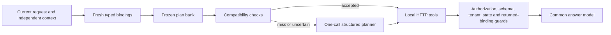

# Verified workflow reuse

This experiment reuses resource-free tool workflows to avoid a planning-model call. It always fetches current tool data. A local binder extracts current identifiers and operands; exact skeleton lookup precedes CPU-local word/bigram TF-IDF retrieval. Compatibility checks are conservative heuristics, not proof of semantic intent.

The implementation is isolated in `src/router_lab/reuse/`. The original router and privacy study remain available. Source/configuration archives are under `results/reuse/archive/`; `.env` is excluded. All paid calls share `results/budget.jsonl` and the original run lock.



The four policies are `fused`, `exact`, `ordinary`, and `verified`. Ordinary semantic reuse skips cache compatibility only; it retains every execution guard. It is a read-only diagnostic. All policies use the same planning model/settings, tool state, tool schemas, answer prompt, and output limits. Conceptual explanations and requests with missing required bindings bypass retrieval, use the planner response directly, and avoid a second answer call. At most three tool invocations and one uncached recovery plan are allowed per endpoint; SDK retries are disabled.

## Run the study

For a new paid study, use a fresh directory directly under `results/`. The commands below use `results/reuse-review`; choose another unused name if it already exists. Keep the checked-in `results/reuse` as saved evidence.

```sh
uv run router-lab reuse --dir results/reuse-review prepare
uv run router-lab reuse --dir results/reuse-review review-family --family issues --reviewer NAME --approve --note 'Reviewed positive and adverse examples'
# Repeat the review for deployments, tests, sources, calculations, comparisons, linked, direct.
uv run pytest tests/test_reuse.py
uv run --env-file .env router-lab reuse --dir results/reuse-review seed
uv run --env-file .env router-lab reuse --dir results/reuse-review pilot
uv run --env-file .env router-lab reuse --dir results/reuse-review run --split dev
uv run router-lab reuse --dir results/reuse-review analyze --split dev --calibrate
```

Inspect `results/reuse-review/calibration.json`. Set `threshold` and `margin` in `results/reuse-review/settings.json` to its selection, then rerun development and calibration if the configuration changed. An exact configuration resumes completed work; changed configurations have separate identities. Pilot rows count toward development only for the exact final configuration. Calibration evaluates a fixed threshold/margin grid on development references only, maximizing accepted correct plans with zero incorrect hits and breaking ties toward stricter settings. History and held-out labels never participate in calibration.

```sh
uv run router-lab reuse --dir results/reuse-review analyze --split dev
uv run router-lab reuse --dir results/reuse-review freeze
uv run --env-file .env router-lab reuse --dir results/reuse-review run --split test
uv run router-lab reuse --dir results/reuse-review analyze --split test
PHOENIX_COLLECTOR_ENDPOINT=http://localhost:6006/v1/traces uv run --env-file .env router-lab reuse --dir results/reuse-review publish
```

`freeze` requires all eight approved contract hashes, the complete final development matrix, matching calibration, zero observed incorrect verified development hits, and an affordable remaining-work projection. It fixes source, inputs, references, bank, model settings, endpoint, tool contracts, pricing assumptions, and reviews. Source or configuration changes after freeze invalidate held-out execution. Test-time admission is disabled.

Phoenix publication expects the full OTLP HTTP collector URL, including `/v1/traces`. The saved findings retain the recommendation, global spending audit, exploratory paired p95 interval and sensitivity bound for shared family wording. Their original generation provenance remains in the execution verification.

The pilot cap is $3. The core cap is $20 including history construction and pilot calls. The global ceiling is $50 with at least $5 reserved. Unknown provider usage retains the full estimate. Paid execution is sequential. A failed projection requires selecting the prespecified ordinary-policy diagnostic subset (first two clusters per family: 16 held-out clusters) before freeze; if that still exceeds the cap, stop at the pilot. Report that limitation rather than silently shrinking other conditions.

An interrupted endpoint is never automatically retried on process restart. `endpoints.jsonl`, `outcomes/`, `model-calls.jsonl`, and the global budget ledger preserve paid-work evidence. A pending endpoint or an outcome missing its reporting commit requires manual reconciliation. This conservative stop prevents duplicate calls even in the crash window after durable outcome storage. Do not erase journal entries to resume.

## Data and trust boundaries

There are 16 history requests, 24 development clusters, and 64 held-out clusters over eight families. Generated identifiers do not overlap across splits; variants of a base request retain a single cluster identity. The eight family contracts are reviewed once; substitutions are explicitly labeled derived references, not individually human-approved cases.

`inputs.jsonl` contains only requests, independently supplied contexts, fixture state, and scheduling metadata. Scoring paths/facts live in separate `references-history.jsonl`, `references-dev.jsonl`, and `references-test.jsonl`. Runtime modules import neither dataset construction nor scoring. The model receives only a validated `RequestInput`, locally extracted bindings, the public tool catalog, and recovery feedback. History admission receives an offline history-success certificate and parameterizes successful plans; it receives no expected paths, expected facts, or development/held-out labels.

The frozen bank contains slot references, ordered tool steps/dependencies, structural signatures, namespaces, tool-contract hashes, and provenance. It contains no historical argument values, result payloads, or answers. Exact skeletons retain wording, negation, order, multiplicity, and constraints while replacing known values. Unknown semantics and ambiguous aliases cause verified misses. Named comparison roles are bound explicitly; noncommutative operand order is retained. Associated test runs come from the current issue record, never a stored run identifier.

Tools run through a loopback HTTP service with fresh state for each paired endpoint. The service checks capabilities and resource grants. Responses include authoritative record identifiers, tenant, and a state version; the adapter checks them before exposing results to the answer model. No tool performs writes or executes tests.

## Measurements and interpretation

End-to-end timing starts before the endpoint journal, covers binding, retrieval, validation, model calls, HTTP tools, fallback and required durable outcome/completion storage, and ends when the response is available. HTTP-service teardown, offline scoring/reporting, and Phoenix publication are outside the response interval. Planning, answer, tool, normalization/retrieval, and persistence times are also recorded separately.

Analysis writes an illustrated Markdown report, machine-readable summaries, and five PNG figures under `results/reuse/analysis/SPLIT/`. It reports task/path correctness, wrong bindings, executed authorization violations, results reaching answers, statuses, unnecessary clarification, calls/replans, tokens, provider cached tokens, measured/estimated costs, p50/p95 latency, warm hits/misses, empty-bank behavior, rejection reasons, construction cost and break-even. Scenario reweighting is labeled an estimate, not production traffic.

Task scoring independently checks acceptable ordered execution paths and required current facts in the final answer. It is mechanical evidence and does not replace a semantic or human answer-quality assessment. A blocked unsafe action is a safe failure, not a successful resolution. Pending, transport, semantic, clarification, and abstention outcomes remain distinct. Appropriate abstentions are reported separately and do not count as completed resolutions. The `bad_result_reached_answer` flag conservatively identifies an answer generated after an incorrect execution path; it does not establish that an incorrect resource was explicitly mentioned to the user.

Uncertainty resamples base-request clusters, retaining repetitions and paired conditions. Harmful-cluster bounds remain conservative; 64 clusters cannot support a 1% production-risk guarantee. The engineering targets are 20% lower cost per successful resolution and 15% lower warm median latency than fused planning, with no observed task-success regression or executed authorization violations. p95 remains visible even if the median improves. If deterministic exact reuse captures the benefit, prefer that simpler implementation. This experiment makes no production deployment, concurrency SLO, result-caching, or formal privacy claim.

The research basis is the accepted plan: [Agentic Plan Caching](https://arxiv.org/abs/2506.14852), [Structured Intent Canonicalization](https://arxiv.org/html/2602.18922v2), [Temporal Semantic Caching](https://arxiv.org/html/2605.20630v1), and [OpenAI agent optimization](https://developers.openai.com/cookbook/examples/agent_optimization/optimizing_agents_for_cost_and_quality). The contribution sought here is an observed efficiency/correctness boundary, not invention of plan caching.
