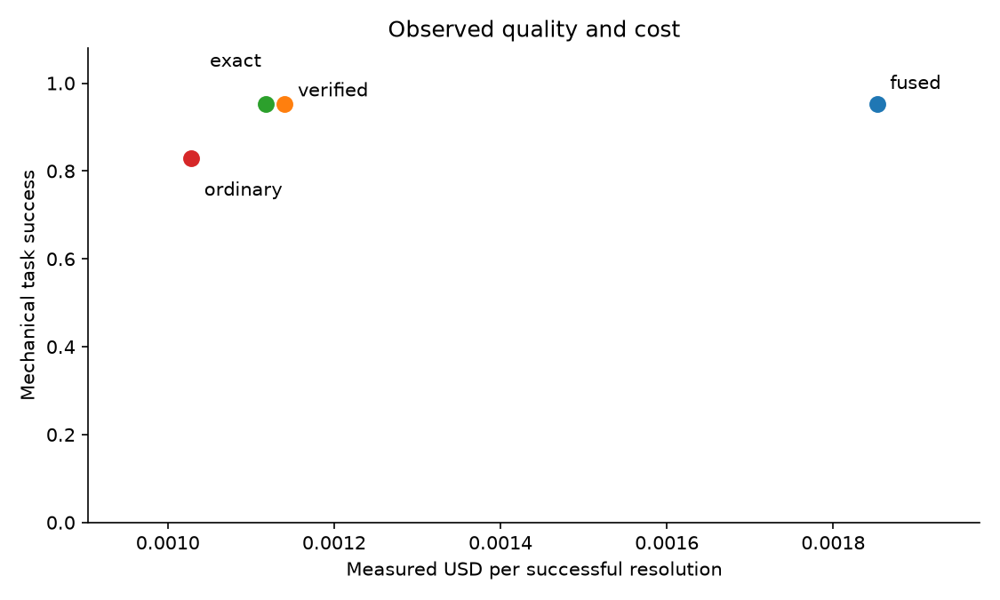

# Reuse the workflow, fetch the current facts

Ashton Liu | Arize take-home | October 29, 2026

**Question:** can recurring support requests skip model planning without reusing stale answers? Exact workflow reuse delivered **39.7% lower cost per mechanical success** and **45.7% lower median latency** than fresh planning. Both achieved **122/128 successes**: 100 completed responses and 22 appropriate clarifications. Six abstentions remain unresolved. These are real model measurements over controlled local synthetic fixtures, not production traffic or human answer-quality certification.

## Motivation and implementation

Support requests often repeat a workflow with a new issue, deployment, test run or operand. [Agentic Plan Caching](https://arxiv.org/abs/2506.14852) motivates storing structured plans while obtaining current external data. Related [structured-intent](https://arxiv.org/abs/2602.18922) and [temporal semantic caching](https://arxiv.org/abs/2605.20630) studies motivate checking parameters and intent beyond textual similarity. My contribution is a measured efficiency/correctness boundary in a small, inspectable implementation.

The Python prototype stores resource-free plans: typed slots, ordered steps, dependencies and provenance. It stores no historical answers or result payloads. A deterministic binder extracts current identifiers and operands. Exact lookup compares normalized wording skeletons; semantic retrieval uses local word/bigram TF-IDF. Misses fall back to the same structured planning model. Every accepted plan still executes current loopback HTTP tools and the common answer path. Capability, tenant, schema and returned-binding guards remain active.

Four policies isolate the tradeoff: fresh fused planning; exact reuse; ordinary semantic reuse; and verified semantic reuse with compatibility checks. Ordinary skips semantic compatibility, retaining execution guards. This read-only diagnostic tests whether authorization and argument validity alone protect intent.

## Controlled comparison

The frozen bank admitted 14 plans from 16 history attempts. Development calibrated retrieval before freeze. Held-out evaluation covered eight families, 64 base clusters, six policy/bank conditions and two repetitions: **768 endpoints**. Sources, settings, references, reviewed family contracts and dependency locks remain frozen. No held-out execution enters the bank.

Exact warm reuse cost **$0.001117 per mechanical success**, versus **$0.001853** for fused warm planning. Median latency was **1,896 ms versus 3,490 ms**. Exact accepted 64 hits with no observed incorrect accepted path. Verified accepted 68 and preserved 122/128 success, but its 38.4% cost and 44.9% median reductions did not improve the exact headline. Costs include failed endpoints, saved usage and frozen prices. Latency includes retrieval, inference, current tools and required durable storage; later scoring and publication are excluded.

<!-- overview-page -->

## The failure Phoenix helps explain

Ordinary semantic reuse accepted **18 incorrect paths among 94 hits** and achieved **106/128 successes**. The failures span issues, sources, calculations and comparisons. Zero observed authorization violations did not imply intent correctness.

For `test-calculations-02`, warm repetition 1, ordinary reuse matched an addition plan to a subtraction request. It executed `calculate(add, 4, 10408)`, returning **10412**, instead of subtraction yielding **-10404**. The final answer noticed the operation mismatch. This was unsuccessful resolution, not a confidently wrong numerical answer. Verified rejected the mismatch and called the fresh planner; exact and fused comparators also used subtraction.

**Phoenix traces reconstruct saved measured executions. Publication is outside endpoint latency. Existing grades are mechanical CODE evaluations.** Root spans expose policy, bank state, hit, status and cost; children expose model calls and authoritative tool arguments/results. The gallery follows the failure from root to wrong operation, then to the verified comparator. A paired issue lookup shows exact reuse making one LLM call versus fresh planning's two, while both execute current tools.

The [portable gallery and trace index](phoenix-measured/README.md) include selected saved records and provenance. Retrieval scores and rejection reasons are saved-record evidence, not Phoenix-visible fields. Images remain usable without a local server.

<!-- overview-page -->

## Challenges, recommendation and limits

The main engineering challenge was preserving the distinction between a valid tool invocation and the requested workflow. Another was accounting across crashes: endpoint, model-call and outcome journals prevent an ambiguous interruption from silently becoming a free call or duplicate retry. Paired analysis keeps both repetitions within their base cluster; 768 endpoints do not mean 768 independent tasks.

Use **exact reuse for v1** on this workload. It met the local efficiency targets with the simpler policy. Semantic verification remains useful defense, but its four additional hits did not earn better observed efficiency. History construction cost $0.0730; estimated exact break-even is 105 requests at the observed recurrence, excluding engineering and review labor.

Limits remain material. This small, deliberately recurring, read-only fixture workload uses shared family wording and provider token caching. A zero-event bound across 64 clusters still permits about 4.6% harmful-cluster incidence under independence. Exact misses had 4,735 ms p95; verified empty-bank p95 was 8.2% higher than fresh empty-bank planning. Warm median savings establish no tail-latency guarantee.

A **deliberately selected and diagnostic** 24-endpoint human audit covers all eight families. Preparation is complete; actual reviewer judgments remain pending. Mechanical scoring cannot establish full grounding, helpfulness or satisfaction. Appropriate abstention stays separate from successful resolution. Future disagreements must change the interpretation while preserving original measurements.

Privacy and routing remain labeled extensions: privacy has controlled development observations with human/held-out judgments pending; routing has implemented controls and synthetic demonstrations with measured conclusions pending. The [notebook](../notebooks/trace-evidence-lab.ipynb), [technical appendix](../output/cookbook/trace-evidence-lab.pdf), [study guide](reuse-study.md) and [six-minute path](walkthrough.md) support offline review without new paid calls.
