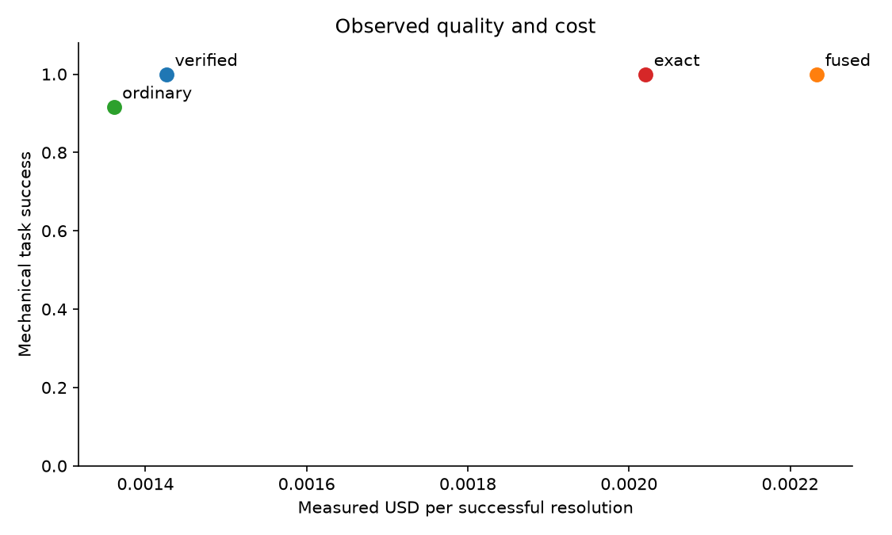
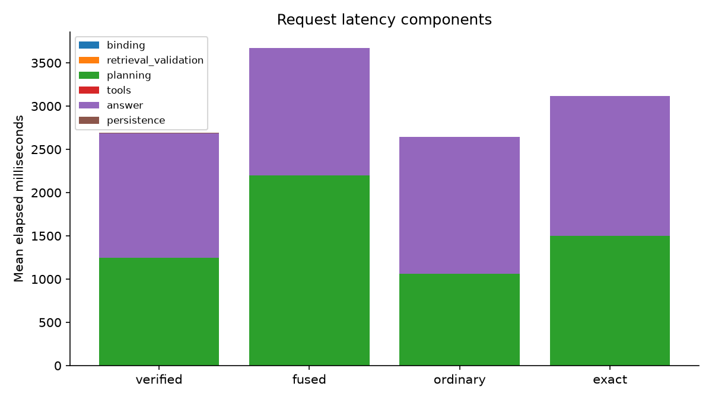
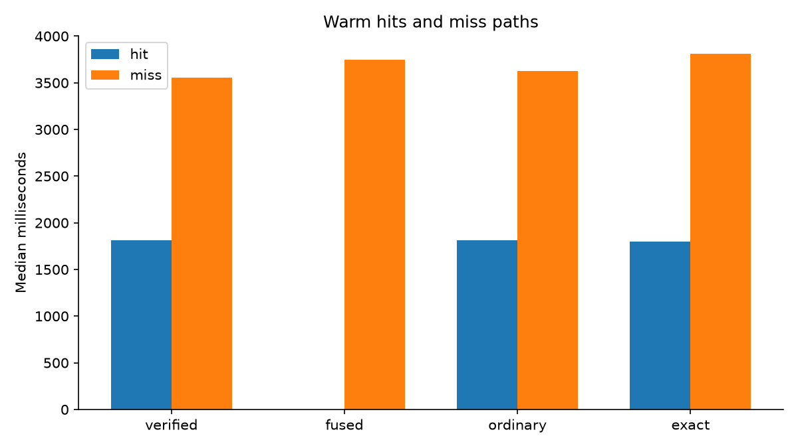
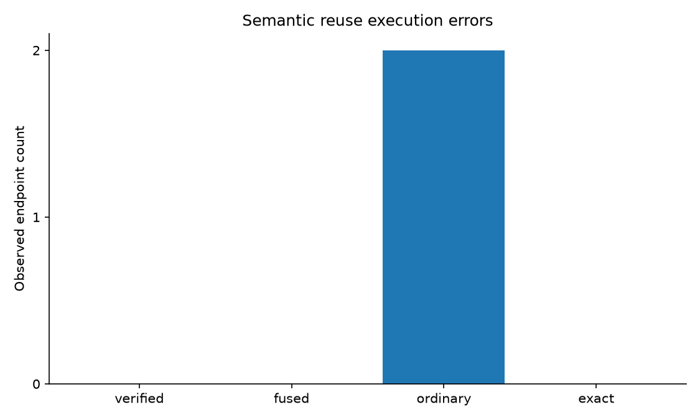
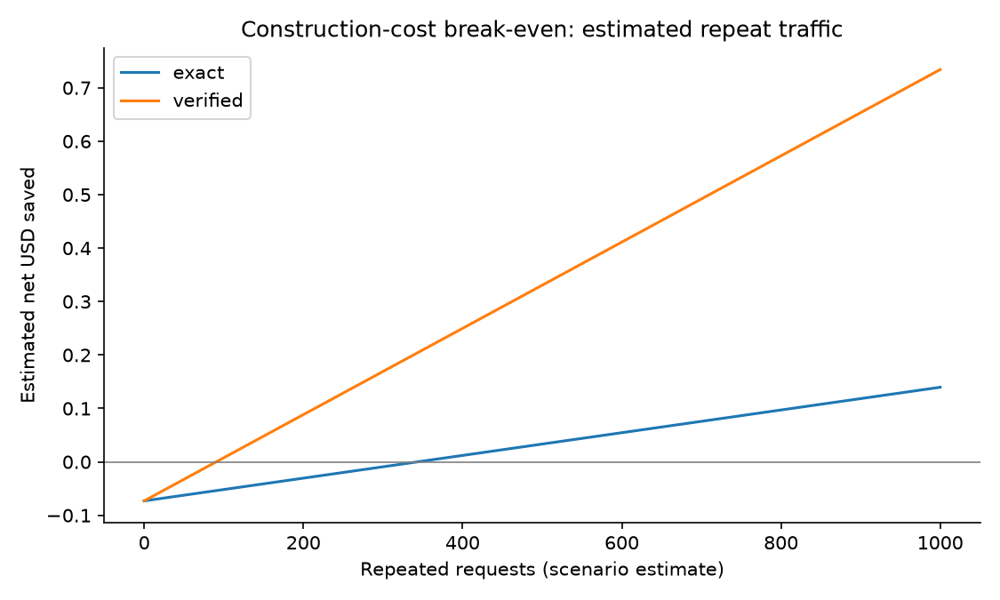

# Verified plan reuse: measured local experiment

Split: dev. Measured 144/144 endpoints.

All reported model costs and latencies come from real calls; tools use the local HTTP fixture service.

|Condition|Success|USD/success|p50 ms|p95 ms|Planning calls|Reuse hits|Incorrect hits|
|---|---:|---:|---:|---:|---:|---:|---:|
|exact:warm|24/24|0.0020206875|3512.0|4535.0|16|8|0|
|fused:empty|24/24|0.0023419791666666667|3775.7|5317.6|24|0|0|
|fused:warm|24/24|0.0022333125|3745.0|4435.9|24|0|0|
|ordinary:warm|22/24|0.0013609818181818181|2136.1|4980.2|11|13|2|
|verified:empty|24/24|0.0021130625|3812.6|5012.1|24|0|0|
|verified:warm|24/24|0.0014262500000000002|2667.0|3847.1|14|10|0|

Observed engineering targets met: True. This is an observation, not a production guarantee.

Paired intervals resample base-request clusters, keeping repetitions and conditions together. See summary.json for intervals, harmful-regression bounds, token accounting, statuses, and rejection reasons.

Construction cost includes history attempts. Break-even and reweighted repeat-rate scenarios are estimates, not measured production traffic.

Scoring checks execution paths, resource roles, and required facts in answers. It is not a semantic or human answer-quality judgment. Blocked unsafe actions count as safe failures, not completed tasks.

## Limits

- mechanical path and required-fact checks do not prove semantic task success
- 64 held-out clusters cannot establish a 1% production-risk guarantee
- read-only local fixture service with real model calls; no production traffic or concurrency claim
