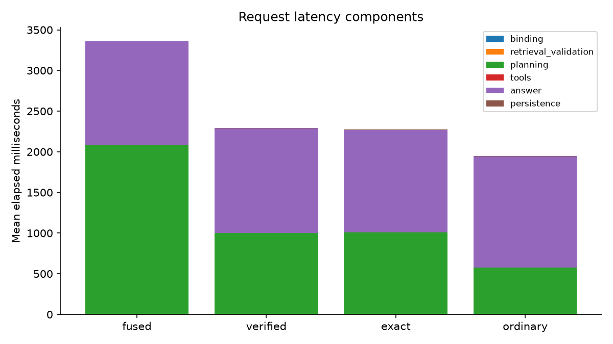
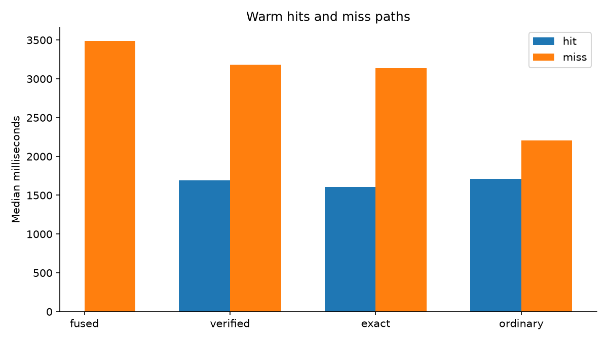
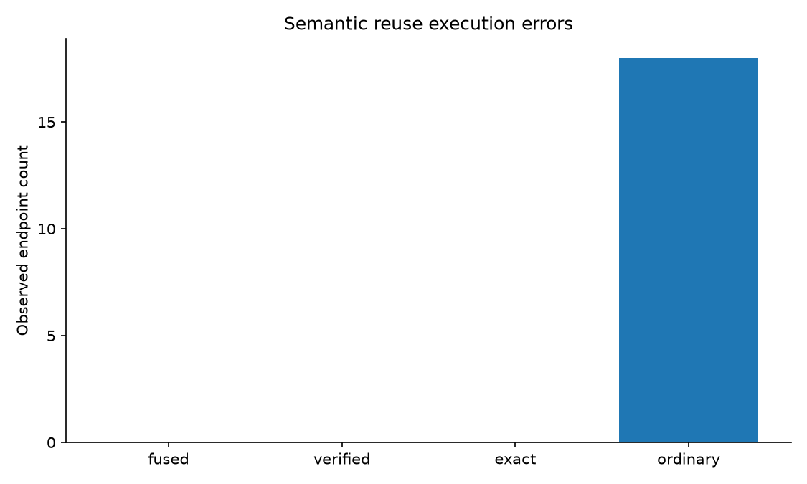
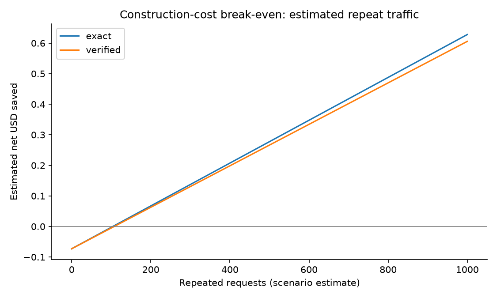

# Verified plan reuse: measured local experiment

Split: test. Measured 768/768 endpoints.

All reported model costs and latencies come from real calls; tools use the local HTTP fixture service.

|Condition|Success|USD/success|p50 ms|p95 ms|Planning calls|Reuse hits|Incorrect hits|
|---|---:|---:|---:|---:|---:|---:|---:|
|exact:warm|122/128|0.0011172868852459014|1895.8|4164.4|64|64|0|
|fused:empty|122/128|0.0017501229508196721|3571.7|4440.2|128|0|0|
|fused:warm|122/128|0.001852844262295082|3489.9|4501.0|128|0|0|
|ordinary:warm|106/128|0.0010281962264150942|1776.4|3541.1|34|94|18|
|verified:empty|122/128|0.001796883606557377|3590.7|4802.4|128|0|0|
|verified:warm|122/128|0.0011407459016393442|1922.2|3976.8|60|68|0|

Observed engineering targets met: True. This is an observation, not a production guarantee.

Paired intervals resample base-request clusters, keeping repetitions and conditions together. See summary.json for intervals, harmful-regression bounds, token accounting, statuses, and rejection reasons.

Construction cost includes history attempts. Break-even and reweighted repeat-rate scenarios are estimates, not measured production traffic.

Scoring checks execution paths, resource roles, and required facts in answers. It is not a semantic or human answer-quality judgment. Blocked unsafe actions count as safe failures, not completed tasks.

## Limits

- mechanical path and required-fact checks do not prove semantic task success
- 64 held-out clusters cannot establish a 1% production-risk guarantee
- read-only local fixture service with real model calls; no production traffic or concurrency claim
